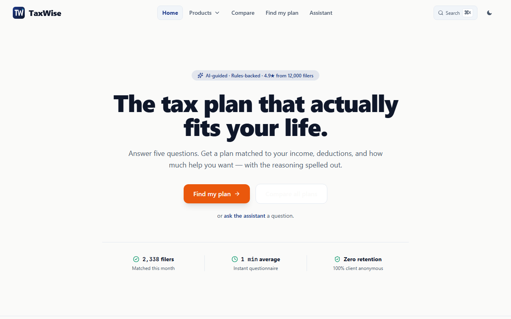
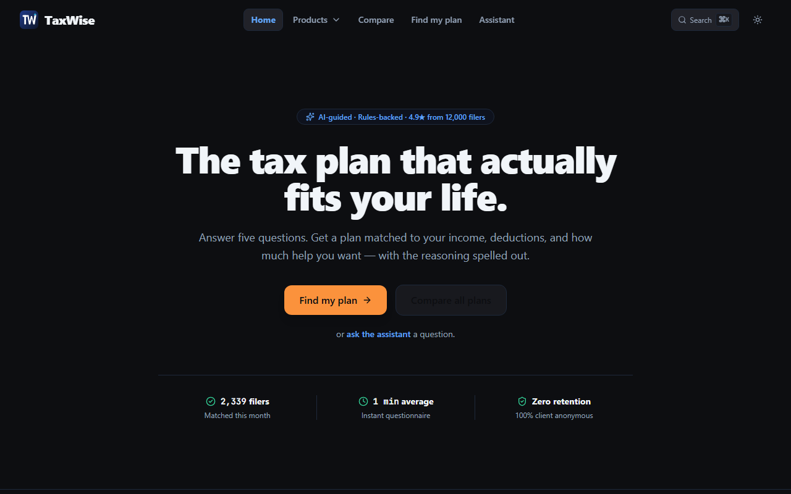

# TaxWise — Full Rebuild

A production-ready tax plan recommender and AI assistant built with **Next.js 14 (App Router)**, **TypeScript**, **Tailwind CSS**, and **framer-motion**. It guides individuals, freelancers, and incorporated businesses to the optimal tax filing tier through a deterministic rules engine with safety-grounded AI assistance.

Live Deployment: [https://tax-wise-nine.vercel.app/](https://tax-wise-nine.vercel.app/)

---

## Architecture & Directory Structure

TaxWise is structured following strict single-responsibility principles (every file is under 200 lines):

```text
src/
├── app/
│   ├── (marketing)/                # Public route group
│   │   ├── page.tsx                # Hero, Trust Counters, Plan Grid, FAQ, Testimonials
│   │   ├── products/               # Catalogue with Typeahead Combobox
│   │   ├── compare/                # Side-by-side feature matrix
│   │   ├── recommend/              # 5-step questionnaire wizard & results
│   │   └── assistant/              # Grounded AI assistant chat interface
│   ├── (admin)/                    # Protected admin route group (Edge middleware gated)
│   │   ├── layout.tsx              # Auth layout
│   │   └── admin/
│   │       ├── page.tsx            # Dashboard (env health, schema status, counts)
│   │       ├── login/page.tsx      # Brute-force protected sign-in
│   │       └── products/page.tsx   # Catalogue inspector and JSON exporter
│   ├── api/
│   │   ├── admin/{login,logout}/   # Admin authentication endpoints
│   │   ├── assistant/route.ts      # LLM orchestrator with safety guardrails
│   │   ├── products/route.ts       # Cached public product catalogue
│   │   └── recommend/route.ts      # Validated rules-engine endpoint
│   ├── layout.tsx                  # Global theme script, fonts, and skip links
│   ├── middleware.ts               # Edge auth check, CSP, HSTS, and security headers
│   ├── sitemap.ts & robots.ts      # SEO rules (disallowing /admin and /api)
│   └── globals.css                 # 60/30/10 design system tokens & accessibility
├── components/
│   ├── ui/                         # Primitives (Button, Modal, Input, Badge, CommandPalette)
│   ├── layout/                     # Chrome (Header, Footer, DesktopNav, MobileNav, Dropdown)
│   └── marketing/                  # Page sections (Hero, Testimonials, PricingFaq, PlanGrid)
├── features/
│   ├── recommend/                  # Rules engine, priority shadowing, warnings, export-pdf
│   ├── assistant/                  # Safety screening, signals, grounding, Groq client
│   └── products/                   # Strongly typed plans catalogue & search utilities
├── hooks/                          # Extracted state (useQuestionnaire, useScrollProgress)
├── lib/                            # Edge Web Crypto auth, rate limiting, and Zod schemas
└── types/                          # Domain TypeScript declarations
```

---

## Getting Started

### Prerequisites
- Node.js 18.17+ or Node.js 20+
- npm 9+

### Local Setup
```bash
# 1. Clone the repository and install dependencies
git clone https://github.com/AleeyHussain/TaxWise.git
cd TaxWise
npm install

# 2. Configure environment variables
cp .env.example .env.local

# 3. Start development server
npm run dev
```

Open [http://localhost:3000](http://localhost:3000) to view the application.

---

## Environment Variables & Admin Credentials

To protect the admin dashboard and configure the AI assistant, the following environment variables are required:

| Variable | Scope | Description |
| --- | --- | --- |
| `ADMIN_USERNAME` | Server / Middleware | Plaintext administrator username. |
| `ADMIN_PASSWORD_HASH` | Server only | bcrypt hash (cost 12) of administrator password. |
| `ADMIN_SESSION_SECRET` | Server / Middleware | 32+ byte cryptographic key used to sign HMAC-SHA256 session cookies. |
| `GROQ_API_KEY` | Server only | Groq API key for Llama 3.3. If omitted, assistant runs in simulated fallback mode. |
| `GROQ_MODEL` | Server only | Model identifier (defaults to `llama-3.3-70b-versatile`). |

> **Vercel Instructions**:
> Place these environment variables in **Vercel → Settings → Environment Variables** (Production + Preview). Never commit them. Rotate the secret by regenerating and redeploying if you suspect compromise.

### Generating Admin Credentials
Generate your bcrypt hash and session secret locally using Node.js:

```bash
# Generate bcrypt password hash (cost 12)
node -e "console.log(require('bcryptjs').hashSync(process.argv[1], 12))" "YourStrongPasswordHere"

# Generate 32-byte hex secret
node -e "console.log(require('crypto').randomBytes(32).toString('hex'))"
```

---

## Security Hardening (Phase 2 & 3)

- **Edge Authentication**: Protected routes (`/admin/*`) are intercepted in `src/middleware.ts` using Web Crypto HMAC-SHA256 cookie signatures. Unauthenticated requests are redirected to `/admin/login`.
- **Brute-Force Rate Limiting**: Sliding-window rate limiter locks out login attempts exceeding 5 tries per 15 minutes per IP with HTTP `429`. Public POST endpoints are capped at 20 req/min.
- **Strict Boundary Validation**: API routes reject bodies exceeding 8 KB with HTTP `413` and enforce Zod validation (`questionnaireAnswersSchema`). Invalid inputs return HTTP `400` instead of failing open.
- **Security Headers & CSP**: Content Security Policy, HSTS, `X-Content-Type-Options: nosniff`, and `X-Frame-Options: DENY` applied to all responses.
- **Zero Secret Leakage**: Verified that no server secrets (`GROQ_API_KEY`) leak into `.next/static/` client bundles.

---

## Feature Highlights (Phases 4 & 5)

1. **60/30/10 Design System & Typography**: Inter variable body font, Cal Sans headings, and JetBrains Mono code styling. Primary navy trust (30%), surface off-white (60%), and orange CTA buttons restricted to hero and final CTA.
2. **Accessible Motion**: Purposed animations via `framer-motion` (shrink header, nested product dropdown, staggered hero reveal, parallax layer). Disables all animations when `prefers-reduced-motion: reduce` is detected.
3. **Command Palette (`⌘K` / `Ctrl+K`)**: Rapid typeahead navigation powered by `cmdk` to jump directly to plans, comparisons, or the assistant.
4. **Shareable Recommendation Links**: State encoded as base64 in `/recommend?data=...` with instant rehydration and dynamic OpenGraph social preview metadata.
5. **One-Click PDF Export**: Client-side summary generation via `jspdf` including selected tier, match confidence, detailed reasons, matched factors, warnings, and legal disclaimer.
6. **Scenario Explorer ("What if?" Mode)**: Modal allowing users to adjust income sources or expert guidance preferences and instantly recalculate recommendations.
7. **Typeahead Combobox**: `/products` features an accessible combobox suggesting supported features and plans as the user types.
8. **Glassmorphism Design System**: Frosted glass surfaces (`.glass`, `.glass-card`, `.glass-elevated`) across cards, headers, dropdowns, and modals with backdrop blur and specular highlights.
9. **Pointer-Tracking AI Bot Companion & Quick Chat Drawer**: Floating animated bot that glides along a vertical straight line tracking cursor position with reactive eye gaze. Clickable to reveal a site-wide quick chat assistant drawer with prompt chips and live AI answers.
10. **Interactive Plan Comparison Matrix**: Fast category tabs and "Highlight differences only" toggle on `/compare` for side-by-side plan evaluation without horizontal fatigue.

---

## Visual Showcase (Light & Dark Mode)

| Light Theme | Dark Theme |
|:---:|:---:|
|  |  |

Interactive motion demo video is available at [`public/proof/taxwise-ui-motion.webm`](./public/proof/taxwise-ui-motion.webm).

---

## How to Add a New Plan

1. Open `src/features/products/` and add the plan definition to the appropriate category module (e.g., `standard-plans.ts`, `personal-plans.ts`, or `corporate-plans.ts`).
2. Provide all metadata fields:
   ```typescript
   export const myNewPlan: Product = {
     id: "my-new-plan",
     name: "My New Plan",
     price: 49.99,
     currency: "CAD",
     category: "personal",
     tagline: "Short one-line description",
     bestFor: "Target demographic description",
     highlights: ["Highlight 1", "Highlight 2"],
     notSupported: ["Excluded feature"],
     supports: {
       ...NO_FEATURES,
       salaryIncome: true,
       donations: true,
     },
   };
   ```
3. Export the plan in `src/features/products/catalogue.ts` and update the recommendation rules in `src/features/recommend/engine.ts` if priority rules apply.
4. Run tests and verify the build:
   ```bash
   npm test
   npm run build
   ```

---

## Testing & Quality Assurance

Run the test suite across domain logic, security guards, and the rules engine:

```bash
# Run all unit and regression tests
npm test

# Run tests in watch mode
npm run test:watch
```

Current test coverage: **60 passing tests** across 9 test suites (`engine.test.ts`, `validation.test.ts`, `safety.test.ts`, `simulated.test.ts`, `grounding.test.ts`, `orchestrator.test.ts`, `catalogue.test.ts`, `search.test.ts`, and `security.test.ts`).

---

## Deployment Checklist

- [x] Run `npm test` — all test suites passing.
- [x] Run `npm run build` — zero errors, zero warnings.
- [x] Verify line-counts — zero files in `src/` over 200 lines.
- [x] Audit client bundles for secrets (`Select-String -Path .next\static\**\*.js -Pattern 'GROQ_API_KEY'`).
- [x] Configure production environment variables in Vercel.
- [x] Confirm Edge middleware protects `/admin` routes.
- [x] Push commits to `origin/main` to trigger automated Vercel build.

---

## Author

**Ali Hussain** — [alihussainsinbox@gmail.com](mailto:alihussainsinbox@gmail.com)
